# 经停 Stopover

[中文](README.md) · **English**

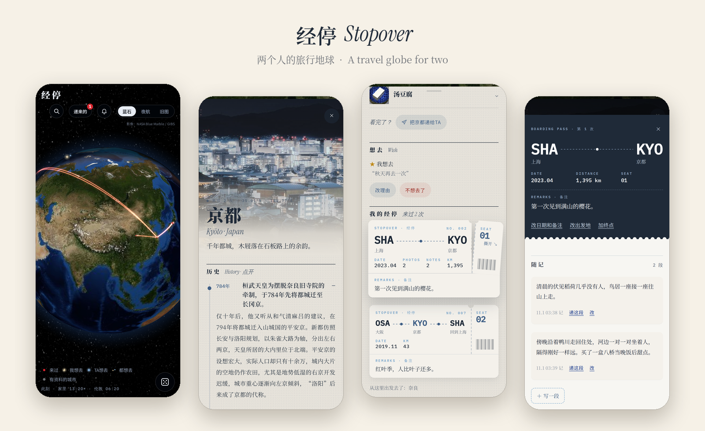

**A travel globe for two: the places you've been glow red on the globe, and every stopover is a boarding pass whose stub you tear off to open it.**

Mark the cities you've been to on a globe. Every stopover is a boarding pass — where you came from, where you went next, the dates, a one-line remark, a few notes and photos. Star the places you want to go: gold for you, blue for the person you travel with. Anything you've been to or dream of can be handed to them, and the two of you talk it over right on the city card.

- 852 cities come with a long-form Chinese page (history, culture, sights, food, with Wikimedia Commons photos). 769 more can be written on demand (DeepSeek + Wikipedia/Wikivoyage), and any place on Wikidata can be added to the map.
- A web app plus a native SwiftUI app — see [`ios/README.en.md`](ios/README.en.md) to build and run it.
- The person you travel with is often your AI companion: it reads your stopovers, comments, stars places and hands things to you over MCP or a small CLI.

## Features

### On your own

- **Three globes**: Blue Marble (蓝石; NASA satellite imagery that sharpens as you zoom in), Night Flight (夜航; NASA Black Marble city lights with the day/night line) and Old Map (旧图; Natural Earth vector borders on a paper texture).
- **Traces on the map**: red dots for places you've been, with a glowing arc flying in from where you set off and on to where you went next if there is one. Places you want to go are stars — gold for you, blue for your partner, a pair when you both want to go. Clocks and day/night follow the time zones in your config.
- **Boarding passes**: one per visit — origin → city → next stop, dates, distance and a remark. Tap to lift it, drag the stub to tear it off (or tap again and it tears itself), and you're in the trip.

- **The trip page** (这一次): notes of any length, photos (deduplicated, EXIF capture date, captions and tags), and editable dates, origin and next stop. On the web and iOS it's a [binder folder](#the-trip-page-a-binder-folder).
- **City pages**: 852 cities have a long-form Chinese page — a history timeline, culture, a sights carousel and a food menu, illustrated with Wikimedia Commons photos and with sources linked on the page. The other 769 have a "Write it up" (整理) button that drafts a page on the spot from Wikipedia / Wikivoyage (needs a DeepSeek key); places not on the map can be found on Wikidata and added.
- **Search in three tabs**: by country / where you've been (grouped by country) / where you want to go (both of you, just you, just your partner). Out of ideas? Roll the dice: it picks a random city from all of them, the unvisited ones, or your stars.
- The web app can be added to your home screen and used like an app; there's also a native SwiftUI app.

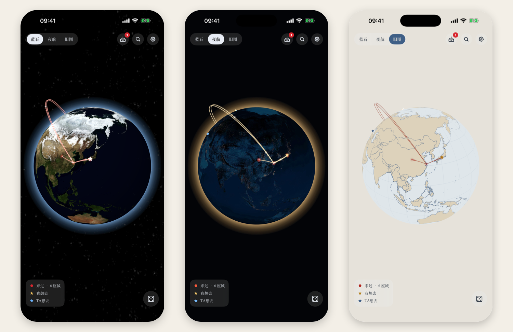

<p align="center">
  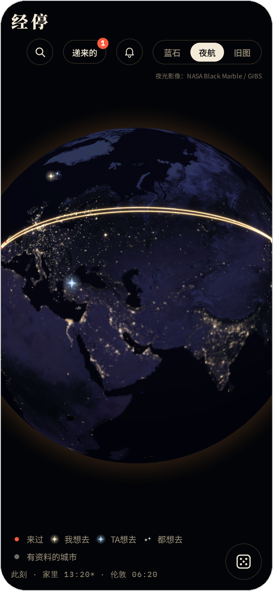
  &nbsp;
  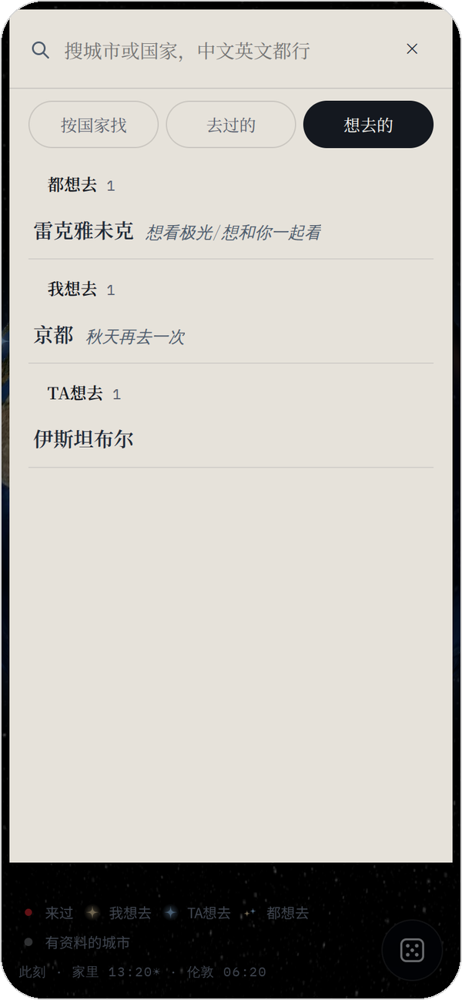
</p>


<p align="center">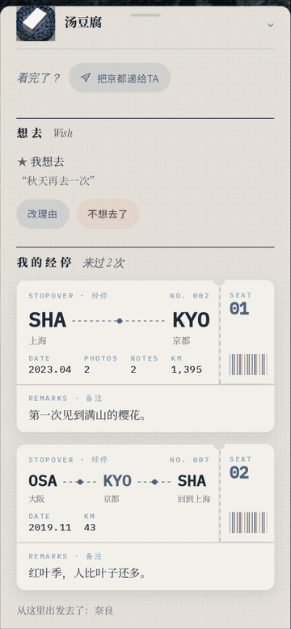</p>
<p align="center"><sub>Like this: tap to lift the pass, drag the stub down and away, and the trip is right behind it.</sub></p>

### The trip page: a binder folder

Each stopover is a frosted-glass folder. The trip's photos peek out of the top, and their colors glow through the glass. The web and iOS versions look almost the same: the screenshots below are from iOS, except the last row, which is the web app.

<p align="center">
  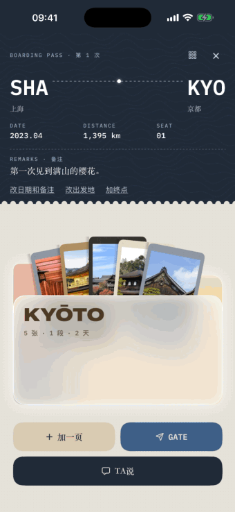
  &nbsp;
  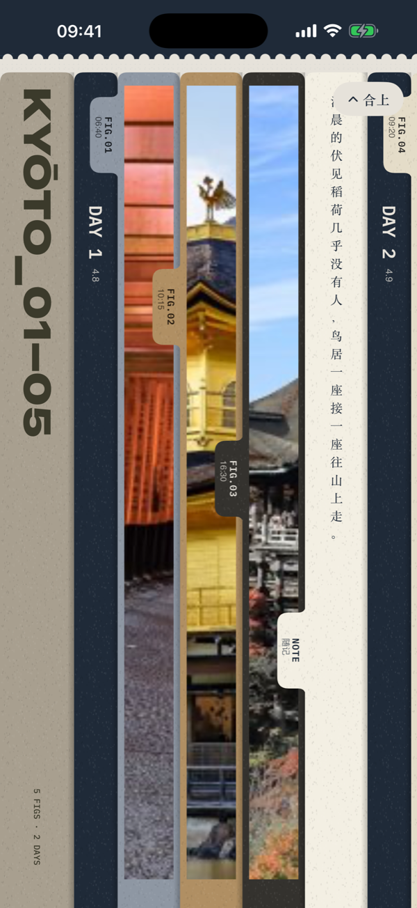
</p>

- **Closed**: the boarding pass, the folder and the add / gate / partner entries all fit on one screen, so you can hand something over or add a page without going through the photos.
- **Open**: the front flap drops and the pages fly out one by one into full-height strips. "合上" (close) at the top right puts them back.
- **Binder strips**: swipe sideways. Pages follow capture time, multi-day trips split into DAY 1, DAY 2, and notes are vertical slips of paper. On iOS, narrow strips center on faces in the photo (the web centers them). The icon at the top right of the pass switches back to a grid.
- **Pull one out**: drag a strip upward or tap it, and it opens into a full page. "插回去" (put back), × or pulling down returns it.

<p align="center">
  
  &nbsp;
  
</p>

- **Poster pages**: every photo gets a page tinted from its own colors. The photo fades into that color and the city name sits across the seam. Captions are set by length: a short line is a headline, a longer one is body text, and a very long one gets a drop cap. The number, day, time and coordinates are printed below.
- **The conversation stays with the photo**: when you hand a photo over, the back-and-forth appears right under its poster page, where you can reply. Tap its slip in the inbox (往来) and the globe flies there and pulls that page out.
- **Captions while uploading**: pick several photos and write a caption for each. Dates are forgiving too: `2019.8.3`, `2019/8/3`, `2019年8月3日` and `20190803` all work, and so does just a year or month.

<p align="center">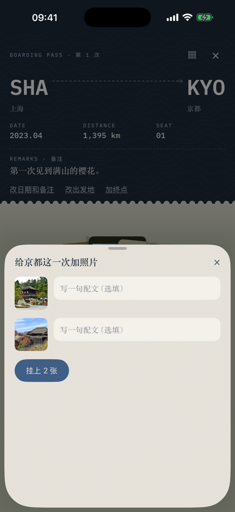</p>

<p align="center">
  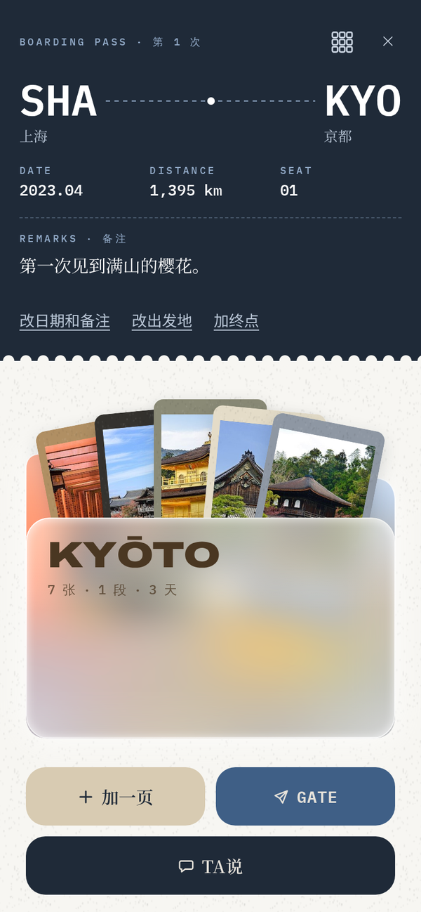
  &nbsp;
  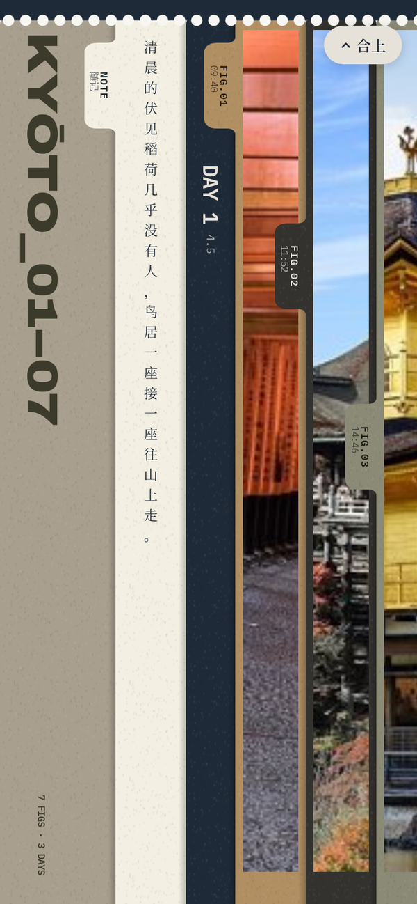
  &nbsp;
  
</p>
<p align="center"><sub>The web app (in a phone browser, or added to the home screen): the closed folder, binder strips and a poster page. Same measurements as iOS.</sub></p>

### Together (optional — switch it all off)

Set `features.share=false` and everything below disappears from the web page, leaving just your own travel log.

- **Hand it over (递给TA)**: a city, a sight, a dish, a whole ticket, or a few hand-picked notes and photos from a trip, with an optional line of your own.
- **Batched and undoable**: everything you hand over and every reply waits as *pending* (待送达) until two quiet minutes pass (`inject.merge_seconds`), then goes out as one message; take it back any time before that.
- **Threads**: "Our conversation" (我们的对话) at the bottom of each city card — one thread per hand-over, plus a "just talking" (平时说的) thread for comments on the city, a trip, a photo or a note. Reply to any message individually.
- **Inbox** (往来): everything either of you handed over, in the top bar — all / mine / your partner's, with their new wishes folded in. A red dot marks anything from your partner you haven't opened.
- **AI companions**: your partner reads, comments, stars (blue) and hands things over via MCP or the CLI, and the tool output is kept short to save tokens (see below and [`AGENT.md`](AGENT.md)).
- **Inject into your main chat**: optionally POST what you hand over to your chat app (`inject.url`), with signed photo links and chat cards you can embed in an iframe.
- **Push**: when your partner comments, hands you something or stars a place, your devices get a notification — Web Push for the web app, APNs for native iOS.

<p align="center">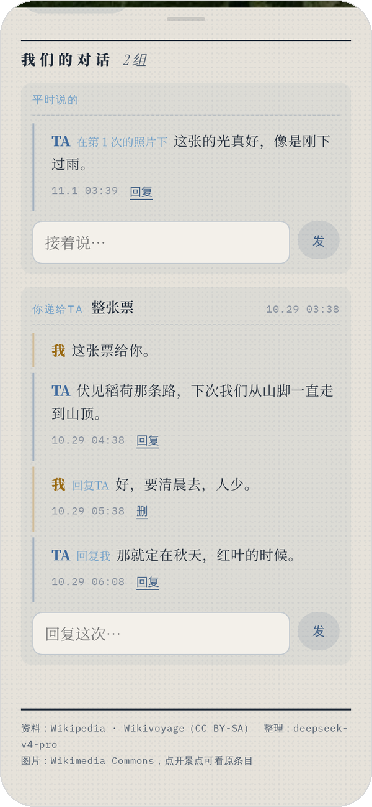</p>

## Run it

```bash
pip install -r server/requirements.txt
cp server/config.example.json server/config.json   # names, home, default origins, clocks, partner
python3 server/seed_demo.py                         # optional: a few made-up trips and a short conversation
python3 server/stopover.py                          # → http://localhost:8000
```

- Runtime data lives in `var/` (`stopover.db`, `photos/`, `vapid.json`), which is git-ignored.
- Environment variables: `STOPOVER_VAR` (data dir), `STOPOVER_CONFIG` (config file), `STOPOVER_HOST` / `STOPOVER_PORT`.
- **There is no login.** Run it on your own machine, or behind your own auth.
- On-demand city pages need DeepSeek: `export DEEPSEEK_API_KEY=...` (optionally `STOPOVER_CONTACT=your email`, used in the User-Agent for Wikipedia/Nominatim). Everything else works without it; only that button will report an error.
- The full HTTP API — for re-implementing the server in another language or wiring up an iOS client — is in [`docs/API.md`](docs/API.md).

## Configuration

`server/config.json` (when it's missing, `config.example.json` is used as a whole). It's re-read on every request, so edits apply without a restart. Keys starting with `_` are comments.

| key | default or example | meaning |
|---|---|---|
| `me` | `"我"` | Your display name. |
| `partner` | `"TA"` | Your partner's display name. |
| `home` | Shanghai | `{"label","lat","lng","tz"}`: where the globe opens; `label` is what "home" is called in origin pickers; clocks with the same `tz` use these coordinates for day/night. |
| `default_origin` | `{"domestic":"shanghai","abroad":"shanghai"}` | Default origin city id for new check-ins, separately for domestic and abroad. |
| `domestic_countries` | China, Hong Kong, Macao, Taiwan | Which countries count as domestic (Natural Earth English names). |
| `clocks` | home + London | `[{"label","tz","lat"?,"lng"?}]`: clocks in the bottom-left corner; those with coordinates draw a sun / moon. |
| `gen.daily_max` | `20` | Daily cap on on-demand city pages. |
| `partner_key` | `""` | The partner's key (Bearer). Empty = no AI access; partner features are view-only. |
| `features.share` | `true` | `false` hides the hand-over, conversation, inbox and notification UI. |
| `public_url` | `""` | The site's external address, used to make links in webhooks, pushes and cards absolute. |
| `inject.url` | `""` | Where your hand-overs are POSTed; empty = nothing is sent and the partner pulls the inbox. |
| `inject.headers` | `{}` | Extra request headers for the POST. |
| `inject.merge_seconds` | `120` | Seconds of quiet before pending items go out as one message (undoable until then). |
| `inject.max_images` | `9` | Max photo links per message. |
| `inject.timeout` | `30` | Webhook timeout in seconds. |
| `inject.template` | `〔经停 Stopover · 来自{me}〕\n{body}` | Message template; variables `{me}` `{partner}` `{body}` `{n}`. |
| `push.title` | `"经停"` | Push notification title. |
| `push.web.vapid_subject` | `mailto:you@example.com` | Contact for Web Push (VAPID). |
| `push.web.enabled` | `true` | `false` turns Web Push off. |
| `push.apns.key_path` / `key_id` / `team_id` / `bundle_id` | `""` | APNs `.p8` key path and ids; enabled only when all four are set and the file exists. |
| `push.apns.env` | `"production"` | Gateway to use when a device doesn't say (`sandbox` / `production`). |

Environment variables: `STOPOVER_VAR`, `STOPOVER_CONFIG`, `STOPOVER_HOST` (default `127.0.0.1`), `STOPOVER_PORT` (default `8000`), `DEEPSEEK_API_KEY`, `STOPOVER_CONTACT`.

## Connect your partner

**1. The key.** Set `partner_key` in `server/config.json` (a long random string: `python3 -c "import secrets;print(secrets.token_urlsafe(32))"`). Requests carrying `Authorization: Bearer <partner_key>` act as the partner; everything else is you. With no key set, the partner side is view-only in the web page and no AI can get in. The partner can read everything, comment, star places (in blue) and hand you cities, sights and dishes; it cannot edit your trips, notes or photos.

**2. MCP.** The server speaks MCP at `POST /mcp` (a stateless subset of streamable HTTP, JSON responses, key required). Tools: `inbox` `look` `read` `img` `say` `wish` `unwish` `wishes` `share` `been` `wander` `gen` — usage is in [`AGENT.md`](AGENT.md), which is written for your companion to read, so just hand it over.

Any streamable-HTTP client (e.g. Claude Code):

```bash
claude mcp add --transport http stopover https://example.com/mcp --header "Authorization: Bearer YOUR_PARTNER_KEY"
```

```json
{ "mcpServers": { "stopover": { "type": "http", "url": "https://example.com/mcp",
    "headers": { "Authorization": "Bearer YOUR_PARTNER_KEY" } } } }
```

Claude Desktop (bridged to local stdio with `mcp-remote`), in `claude_desktop_config.json`:

```json
{ "mcpServers": { "stopover": { "command": "npx",
    "args": ["-y", "mcp-remote", "https://example.com/mcp", "--header", "Authorization:${STOPOVER_AUTH}"],
    "env": { "STOPOVER_AUTH": "Bearer YOUR_PARTNER_KEY" } } } }
```

**3. CLI.** `cli/stopover.py` is a single file using only the standard library, and it calls the same server-side tools as MCP (`POST /api/partner/tool`). Commands work in English or Chinese.

```bash
export STOPOVER_URL=https://example.com STOPOVER_PARTNER_KEY=YOUR_PARTNER_KEY
python3 cli/stopover.py look 京都          # = 看 京都
python3 cli/stopover.py say d:2 "收到了" 回 c:7
python3 cli/stopover.py img p:4           # saved to $STOPOVER_OUT (default: a temp dir)
```

**4. Handing things over.** What you hand over in the web page (a whole ticket, a few hand-picked notes and photos, a single photo, a city / sight / dish) and your replies wait as *pending* — you can take them back — until `inject.merge_seconds` seconds (default 120) pass quietly, then go out as one message:

- With `inject.url` set: POSTed there (for example, your chat app's incoming-message endpoint, with `inject.headers` attached). A failure is retried once; if that fails too, it stays in the inbox.
- Without it: the partner pulls `GET /api/partner/inbox` (`?mark=1` marks items as fetched), or uses the MCP `inbox` tool.

Webhook payload (`text` is rendered from `inject.template`, variables `{me}` `{partner}` `{body}` `{n}`):

```json
{
  "text": "〔经停 Stopover · 来自我〕\n我递给你：\n· 京都 · 2023.04 · 从上海出发（t:2）\n  照片 2 张（附了 2 张）：p:1　p:2\n  → 目录：look t:2\n  回这一样：say d:4 \"…\"",
  "shares":  [{"id": 4, "items": [{"type": "trip", "id": 2}], "note": "再给你一次"}],
  "images":  ["https://example.com/api/photo/img/1?w=600&s=…", "https://example.com/api/photo/img/2?w=600&s=…"],
  "cards":   [{"url": "https://example.com/card/share/4?k=…", "json": {"kind": "share", "eyebrow": "STOPOVER · 递给TA", "title": "京都", "subtitle": "整张票 · 2023.04", "body": "再给你一次", "who": "me", "theme": "light", "image": "…", "link": "https://example.com/?city=kyoto"}}],
  "replies": [{"id": 5, "target": "share:4", "where": "我递的「京都的整张票」", "text": "那就秋天见。", "reply_to": 4}]
}
```

**5. Chat cards.** Every hand-over and every comment has its own random key. `GET /card/share/{id}?k=…` (`/card/comment/{id}?k=…`) is a small, self-contained card you can put in an iframe (transparent background, max 360px wide, `?theme=light|dark`); `GET /api/share/{id}/card?k=…` returns the same fields as JSON (eyebrow / title / subtitle / body / who / theme / image / link) so other chat front-ends can draw their own. Keys are in `GET /api/state` and in the webhook. Missing or wrong key → 403. Set `public_url` so links in cards, pushes and webhooks are absolute.

**6. Push.** Notifications go to *your* devices when the partner comments, hands you something or stars a place (your own hand-overs don't push — they go through the webhook / inbox above).

- Web: the bell in the top-right corner → "Turn on notifications" (开启通知). VAPID keys are generated into `var/vapid.json` the first time; put your contact in `push.web.vapid_subject`. On iPhone / iPad, add the site to the Home Screen first and open it from there. `web/sw.js` only handles push and notification clicks — no offline cache.
- Native iOS: fill `push.apns` with the `.p8` path, `key_id`, `team_id` and `bundle_id`; the app registers with `POST /api/push/apns {"token","env":"sandbox"|"production"}`. When APNs isn't configured, that endpoint returns `{"ok":false,"reason":"apns not configured"}`.
- Payloads carry `{"route":"stopover","city","target","share_id"?}`, so a tap opens that city (the web app uses `?city=<id>`).

**7. Security.** The server has no login of its own: the web page, your photos and `/api/state` are open to anyone who can reach it — whoever connects is "me". If you put it on the internet, put it behind your own auth / reverse proxy (basic auth, Cloudflare Access, Tailscale…) and let only these paths straight through: `/mcp`, `/api/partner/*` (partner key), `/card/*` (card keys), and `/api/photo/img/*` **with an `s=` parameter** — photo links handed to the partner, sent in webhooks and shown in cards carry a signature `s` (HMAC-SHA256 over the photo id and size, secret auto-generated in `var/secret` on first use). A wrong signature gets 403; photo requests without `s` stay behind your own auth. Keep your keys out of git.

Caddy:

```caddy
example.com {
	@open {
		path /mcp /api/partner/* /card/*
	}
	@signedphoto {
		path /api/photo/img/*
		query s=*
	}
	handle @open {
		reverse_proxy 127.0.0.1:8000
	}
	handle @signedphoto {
		reverse_proxy 127.0.0.1:8000
	}
	handle {
		basic_auth {
			me $2a$14$...   # caddy hash-password
		}
		reverse_proxy 127.0.0.1:8000
	}
}
```

nginx:

```nginx
location ~ ^/(mcp$|api/partner/|card/) { proxy_pass http://127.0.0.1:8000; }
location /api/photo/img/ {
    if ($arg_s = "") { return 401; }      # unsigned photos are for logged-in you only (or add auth_basic here too)
    proxy_pass http://127.0.0.1:8000;
}
location / {
    auth_basic "stopover"; auth_basic_user_file /etc/nginx/stopover.htpasswd;
    proxy_pass http://127.0.0.1:8000;
}
```

Don't want any of this? `features.share=false` hides every hand-over, conversation, inbox and notification control in the web page.

## Deploy & backup

- **Locally**: follow *Run it* and open `http://localhost:8000`. The server binds to `127.0.0.1` by default.
- **On your phone**: run it on your own server, kept alive with systemd / Docker or similar, behind a reverse proxy *with auth* — this is not optional; see *7. Security* above. Then "Add to Home Screen" in your phone's browser and it becomes a full-screen app (iOS push also requires opening it this way).
- **Backup**: everything personal is in `var/` — `stopover.db` (stopovers, notes, conversations, stars), `photos/` (originals and thumbnails), `secret` (photo signing key) and `vapid.json` (Web Push keys; lose it and devices must resubscribe). Back up the database while running with `sqlite3 var/stopover.db ".backup var/stopover-backup.db"`, or stop the server and copy the whole folder. Cities you wrote up on demand and places you added from Wikidata live in `web/data/city/` and `web/data/cities.json` — back those up too.
- **Updating**: `git pull` and restart. If you've written up cities or added places, `web/data/cities.json` will conflict with upstream — back it up first, then merge your extra entries back after pulling (new files in `web/data/city/` are unaffected).

## FAQ

**The city pages are written by AI — are they accurate?**
They're based on Wikipedia / Wikivoyage and rewritten into long-form Chinese by a model, so expect occasional mistakes or outdated details. Sources are linked on every page; check the originals when it matters.

**Do I need a DeepSeek key?**
No. Only the "write up this city" button needs one; the 852 ready-made pages, check-ins, notes, photos, hand-overs and push all work without it.

**Can I use it alone, without the partner part?**
Yes. Set `features.share=false` to hide the hand-over, conversation, inbox and notification UI, and leave `partner_key` empty so nobody can get in.

**Does the partner have to be an AI?**
No, a person works too. But the web page and the iOS app always act as *me*; the partner side goes through the API with `partner_key` — the `cli/stopover.py` CLI, MCP, or `/api/partner/*` directly. So for a human partner the CLI is currently the easiest route; there's no "log in as partner" in the web UI.

**Where do photos go? Are they uploaded anywhere?**
Only to `var/photos/` on your own machine (originals plus 600px / 1600px-wide thumbnails); nothing goes to any third party. Only when you've set `inject.url` (or the partner pulls the inbox) do handed-over photos go out, as **signed** links bound to the photo id and size — change one character and you get 403.

**Do I need a paid Apple developer account for iOS?**
Not to run it in the simulator or on your own phone — a free Apple ID is enough. Only push notifications (APNs) need a paid account. See [`ios/README.en.md`](ios/README.en.md).

**Can I change the map or add cities?**
Adding cities: if search can't find a place, look it up on Wikidata right below the results and add it; to give it a long-form page, tap "Write it up" (整理) or run `pipeline/citygen.py`. Changing the map: the three styles are defined in `STYLES` in `web/index.html` (tile URL, full-globe texture in `web/tex/`, colors) — edit one or add your own; with `?notiles` in the URL only the local textures are used.

## Layout

| | |
|---|---|
| `web/` | Single-page front end (globe.gl + three.js), city data in `web/data/`; `web/sw.js` only handles push |
| `server/` | FastAPI + SQLite back end, also serves `web/`; MCP at `/mcp` |
| `cli/stopover.py` | The partner's CLI (standard library only) |
| `AGENT.md` | Manual for your AI companion |
| `pipeline/citygen.py` | Writes up a city on demand (Wikidata → Wikipedia/Wikivoyage → DeepSeek → Commons photos) |
| `ios/` | Native SwiftUI app ([how to run](ios/README.en.md)) |
| `docs/API.md` | Full API reference: for rewriting the back end or wiring up iOS |
| `docs/` | README images (`docs/img/`; all screenshots use made-up demo data) |

## License

- Code, design and sample data: **CC BY-NC-SA 4.0** (Attribution–NonCommercial–ShareAlike), see `LICENSE`. Free to use, adapt and share, **not for commercial use**; adapted versions must use the same license. This is a source-available project, not OSI open source.
- City texts in `web/data/`: **CC BY-SA 4.0** (derived from Wikipedia / Wikivoyage), see `web/data/LICENSE`. Images are not in the repo; they're hotlinked from Wikimedia Commons under their own licenses.
- The Kyoto photos in the trip screenshots in `docs/img/` are from Wikimedia Commons: *Torii path with lantern at Fushimi Inari Taisha Shrine* by Basile Morin (CC BY-SA 4.0), *Kinkaku-ji14* by dconvertini (CC BY-SA 2.0), *Kiyomizu-dera, Kyoto, November 2016 -02* by Martin Falbisoner (CC BY-SA 4.0), *Kyoto Ginkaku-ji Ginkaku 01* by Zairon (CC BY-SA 4.0) and *L'entrée du palais Ninomaru (Château de Nijo, Kyoto)* by Jean-Pierre Dalbéra (CC BY 2.0); images in the city pages likewise come from Commons under their own licenses.
- Third-party notices are in `THIRD_PARTY.md` (the boarding-pass interaction is based on jal-co/boarding-pass, MIT).
