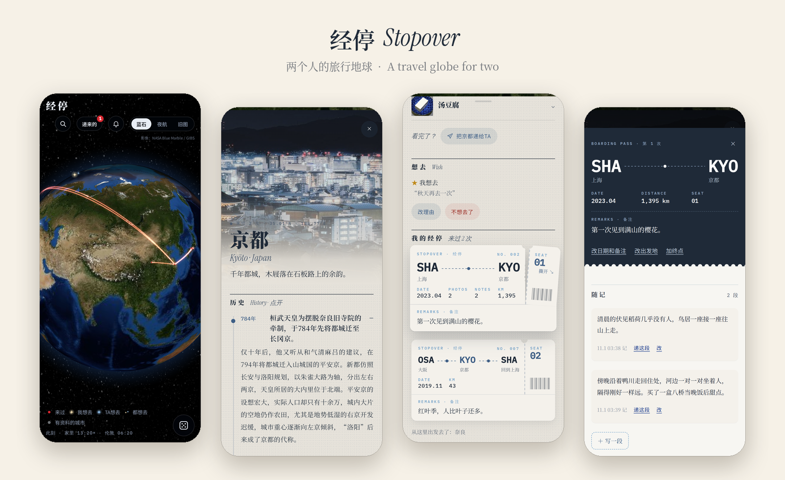
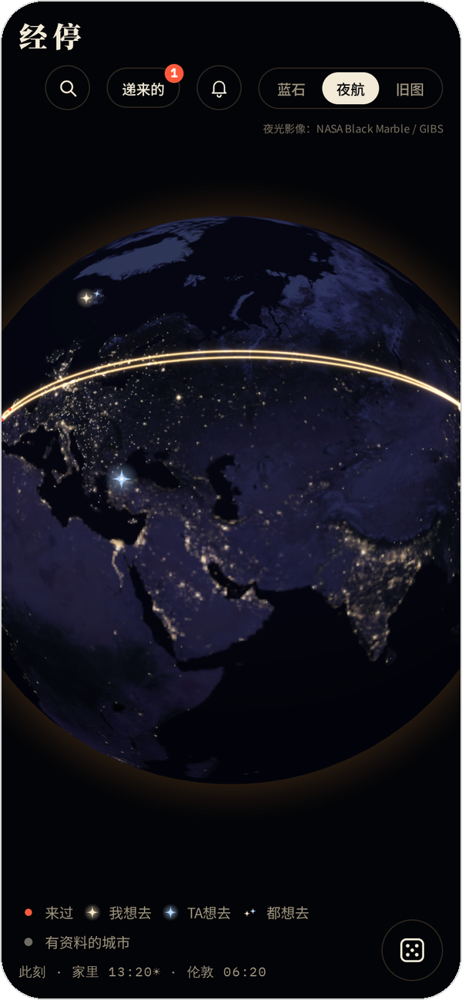
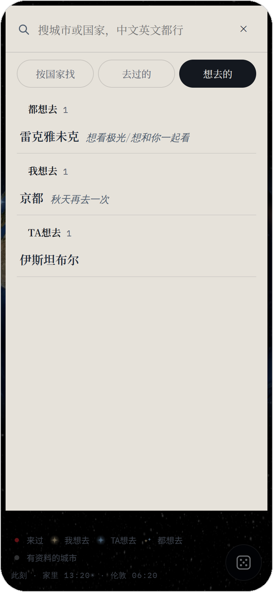
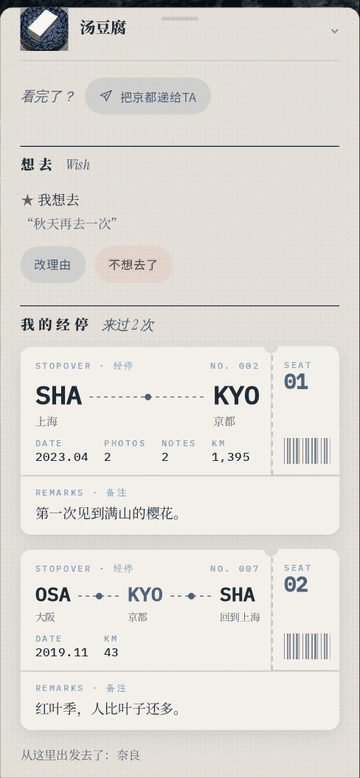
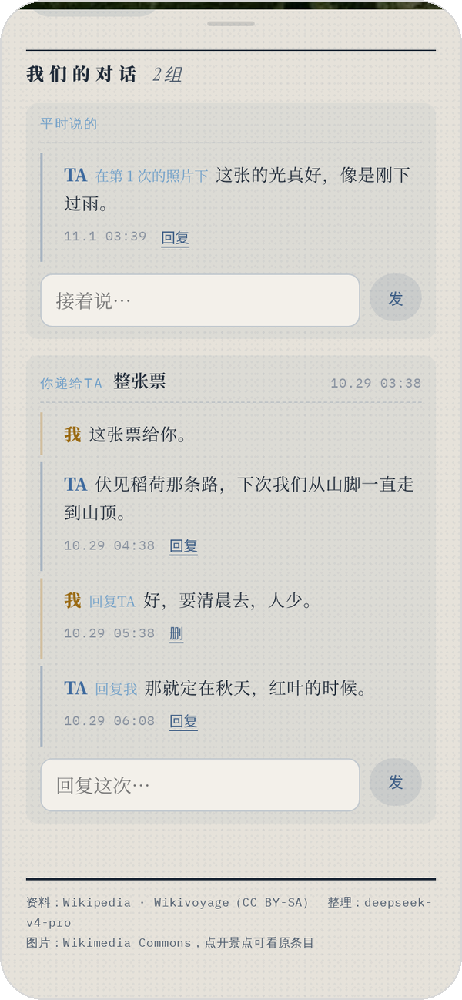

# 经停 Stopover



**两个人的旅行地球：去过的城市是地球上的红点，每一次经停是一张可以撕开存根的登机牌。**
**A travel globe for two: the places you've been glow red on the globe, and every stopover is a boarding pass whose stub you tear off to open it.**

在地球上记下去过的城市。每一次经停是一张登机牌——从哪儿出发、回到哪儿、哪天、一句备注、几段随记、几张照片。想去的地方点一颗星：金色是你的，蓝色是同行的人的。去过的、想去的，都可以递给同行的人，在城市卡片上一来一回地聊。

A travel globe for two. Every stopover is a boarding pass — where you came from, where you went next, the dates, a one-line remark, a few notes and photos. Star the places you want to go: gold for you, blue for the person you travel with. Hand a ticket, a photo or a city to them and talk it over right on the city card.

- 852 座城市有中文长卷（历史、文化、景点、美食，配维基共享图），另外 769 座可以点开现场整理一页（DeepSeek + Wikipedia/Wikivoyage）；地图上没有的地方可以从 Wikidata 加上。
- 852 cities come with a long-form Chinese page (history, culture, sights, food, with Wikimedia Commons photos). 769 more can be written on demand (DeepSeek + Wikipedia/Wikivoyage), and any place on Wikidata can be added to the map.
- 网页 + iOS 原生（SwiftUI），iOS 怎么跑见 [`ios/README.md`](ios/README.md)。Web app plus a native SwiftUI app — see [`ios/README.md`](ios/README.md) to build and run it.
- 「同行的人」常常是你的 AI 伴侣：它通过 MCP 或命令行来看你的经停、留言、点星、递东西给你。The partner is often your AI companion: it reads, comments, stars and hands things to you over MCP or a small CLI.

## 有什么 / Features

### 一个人记 / On your own

- **地球三种风格**：蓝石（NASA Blue Marble 卫星图，越放大越清楚）、夜航（NASA Black Marble 城市灯光，配晨昏线）、旧图（Natural Earth 矢量国界，纸面质感）。**Three globes**: Blue Marble satellite tiles, Black Marble city lights with the day/night line, and a paper map drawn from Natural Earth borders.
- **地图上的痕迹**：来过的城是红点，从出发地拉出一道光带飞过去，有终点的再连回去；想去的是星星——金色是你的、蓝色是 TA 的、两个人都想去的是一对。时钟和昼夜按配置里的时区显示。**On the map**: red dots for places you've been, glowing arcs from where you set off (and on to where you went next), gold stars for you, blue stars for your partner, a pair when you both want to go; clocks with day/night for the time zones you choose.
- **登机牌**：每来一次是一张票——出发地 → 城市 → 终点、日期、里程、一句备注。轻点抬起，拖着存根撕开（或再点一下让它自己撕），进入「这一次」。**Boarding passes**: one per visit — origin → city → next stop, dates, distance and a remark. Lift it, tear off the stub, and you're in the trip.

- **这一次**：随记（长短都行）、照片（自动去重、读拍摄时间、配文和标签）、改日期 / 出发地 / 终点。**The trip page**: notes of any length, photos (deduplicated, EXIF date, captions and tags), editable dates, origin and next stop.
- **城市长卷**：852 座城有中文长卷——历史时间轴、文化、景点轮播、美食菜单，配维基共享资源的图，页面上带来源链接。另外 769 座点开有「整理」按钮，现场从 Wikipedia / Wikivoyage 写一页（要 DeepSeek key）；地图上没有的地方可以从 Wikidata 搜出来加上。**City pages**: 852 long-form Chinese pages (history timeline, culture, a sights carousel, a food menu, Commons photos, sources linked); 769 more can be written on demand; anything else can be added from Wikidata.
- **搜索三栏**：按国家找 / 去过的（按国家分组）/ 想去的（都想去、我想去、TA 想去）。没主意时摇骰子：所有城市、没去过的、或者想去的星星里随机挑一座。**Search** by country, by where you've been, or by your stars — and a **dice** that picks a city at random (any, unvisited, or starred).
- 网页可以「添加到主屏幕」当 App 用；也有 SwiftUI 原生版。The web app installs to the home screen; there's a native SwiftUI app as well.

<p align="center">
  
  &nbsp;
  
</p>


<p align="center"></p>
<p align="center"><sub>就是这样：轻点抬起登机牌，拖着存根往右下撕开，「这一次」就在后面。<br>Like this: tap to lift the pass, drag the stub down and away, and the trip is right behind it.</sub></p>

### 两个人用 / Together（可整块关掉 / optional）

`features.share=false` 会把下面这些在网页上整块藏起来，只剩一个人记。Set `features.share=false` and all of this disappears from the web page.

- **递给 TA**：一座城、一个景点、一道菜、一整张票，或者在「这一次」里挑几段随记、几张照片递过去，可以附一句话。**Hand things over**: a city, a sight, a dish, a whole ticket, or a few hand-picked notes and photos, with an optional line.
- **两分钟合并、可撤回**：连着递的东西和回的话先进「待送达」，安静两分钟（`inject.merge_seconds`）后合成一条送出；送出前随时撤回。**Batched and undoable**: everything waits as *pending* until two quiet minutes pass, then goes out as one message; take it back any time before that.
- **对话组**：城市卡底部「我们的对话」——每次递送单独一组，平时在城市 / 某一次 / 照片 / 随记下说的话归在「平时说的」，可以逐条回复。**Threads**: at the bottom of each city card, one thread per hand-over plus a "just talking" thread for comments on the city, a trip, a photo or a note.
- **收件箱**：TA 递来的东西在顶栏「递来的」，没看过的有红点。**Inbox**: what your partner hands you lands under "递来的" with an unread dot.
- **AI 伴侣**：TA 用 MCP 或命令行来看、留言、点蓝星、递东西，工具输出很省 token（见下文和 [`AGENT.md`](AGENT.md)）。**AI companions** connect over MCP or the CLI; tool output is kept short.
- **推进主对话**：可选把你递的东西 POST 到你的聊天程序（`inject.url`），附签名照片链接和可以 iframe 的聊天卡片。**Inject** into your main chat via a webhook, with signed photo links and embeddable chat cards.
- **推送**：TA 留言、递东西、点星时推到你的设备——网页走 Web Push，iOS 原生走 APNs。**Push** to your devices via Web Push or APNs.

<p align="center"></p>

## 跑起来 / Run it

```bash
pip install -r server/requirements.txt
cp server/config.example.json server/config.json   # 名字、家、默认出发地、时钟、伴侣 / names, home, default origins, clocks, partner
python3 server/seed_demo.py                         # 可选：几条虚构的旅行和对话 / optional demo trips and a short conversation
python3 server/stopover.py                          # → http://localhost:8000
```

- 数据在 `var/`（`stopover.db`、`photos/`、`vapid.json`），已在 `.gitignore` 里。Runtime data lives in `var/` (git-ignored).
- 环境变量 / environment：`STOPOVER_VAR`（数据目录 / data dir）、`STOPOVER_CONFIG`（配置文件 / config file）、`STOPOVER_HOST` / `STOPOVER_PORT`。
- **没有登录。** 只在自己电脑上跑，或者放在你自己的鉴权后面。**There is no login** — run it locally or behind your own auth.
- 现场整理城市要 DeepSeek：`export DEEPSEEK_API_KEY=...`（可选 `STOPOVER_CONTACT=你的邮箱`，用于维基/Nominatim 的 User-Agent）。不设也能用，只是那个按钮会报错。On-demand city pages need `DEEPSEEK_API_KEY`; everything else works without it.
- 完整接口（想用别的语言重写后端，或对接 iOS）见 [`docs/API.md`](docs/API.md)。The full HTTP API — for re-implementing the server or wiring up a client — is in [`docs/API.md`](docs/API.md).

## 配置 / Configuration

`server/config.json`（没有这个文件时整份读 `config.example.json`）。每次请求都重新读，改完不用重启。以 `_` 开头的键是注释。
Read on every request, so edits apply without a restart; falls back to `config.example.json` when missing. Keys starting with `_` are comments.

| 键 / key | 默认或示例值 / default or example | 含义 / meaning |
|---|---|---|
| `me` | `"我"` | 你在界面上的名字。Your display name. |
| `partner` | `"TA"` | 同行的人的名字。Your partner's display name. |
| `home` | 上海 / Shanghai | `{"label","lat","lng","tz"}`：地球开场对准这里；`label` 是「家」在出发地选项里的叫法；和 `tz` 相同的时钟用这里的坐标判断昼夜。Where the globe opens; the home label in origin pickers; day/night for clocks in the same `tz`. |
| `default_origin` | `{"domestic":"shanghai","abroad":"shanghai"}` | 新打卡默认的出发城市（城市 id），国内 / 国外分开。Default origin city id for new check-ins, domestic vs abroad. |
| `domestic_countries` | China, Hong Kong, Macao, Taiwan | 哪些国家算「国内」（Natural Earth 英文国名）。Which countries count as domestic. |
| `clocks` | 家里 + 伦敦 | `[{"label","tz","lat"?,"lng"?}]`：左下角的时钟，有坐标的画日 / 月。Clocks shown on the globe page. |
| `gen.daily_max` | `20` | 每天最多现场整理几座城。Daily cap on on-demand city pages. |
| `partner_key` | `""` | 伴侣的钥匙（Bearer）。空 = AI 调不进来，伴侣部分只能看。The partner's bearer key; empty = no partner access. |
| `features.share` | `true` | `false` 藏起递送、对话、收件箱和通知的界面。`false` hides every two-person UI. |
| `public_url` | `""` | 站点的外部地址，webhook / 推送 / 卡片里的链接用它拼成绝对地址。Base URL for absolute links. |
| `inject.url` | `""` | 你递的东西 POST 到哪；空 = 不发，伴侣自己拉收件箱。Webhook for hand-overs; empty = partner pulls the inbox. |
| `inject.headers` | `{}` | POST 时附带的请求头。Extra headers for the webhook. |
| `inject.merge_seconds` | `120` | 安静多少秒后合成一条送出（之前可撤回）。Quiet period before pending items go out. |
| `inject.max_images` | `9` | 一条里最多附几张照片链接。Max photo links per message. |
| `inject.timeout` | `30` | webhook 超时秒数。Webhook timeout (s). |
| `inject.template` | `〔经停 Stopover · 来自{me}〕\n{body}` | 消息正文模板，变量 `{me}` `{partner}` `{body}` `{n}`。Message template. |
| `push.title` | `"经停"` | 推送标题。Push title. |
| `push.web.vapid_subject` | `mailto:you@example.com` | Web Push 的联系方式。VAPID contact. |
| `push.web.enabled` | `true` | `false` 关掉 Web Push。Turn Web Push off. |
| `push.apns.key_path` / `key_id` / `team_id` / `bundle_id` | `""` | APNs `.p8` 密钥路径和编号，四项都填、文件存在才启用。APNs auth key; all four required. |
| `push.apns.env` | `"production"` | 设备没说明时用哪个网关（`sandbox` / `production`）。Default APNs gateway. |

环境变量 / environment：`STOPOVER_VAR`、`STOPOVER_CONFIG`、`STOPOVER_HOST`（默认 `127.0.0.1`）、`STOPOVER_PORT`（默认 `8000`）、`DEEPSEEK_API_KEY`、`STOPOVER_CONTACT`。

## 接上你的伴侣 / Connect your partner

**1. 钥匙 / The key.** 在 `server/config.json` 里设 `partner_key`（一长串随机字符，`python3 -c "import secrets;print(secrets.token_urlsafe(32))"`）。带 `Authorization: Bearer <partner_key>` 的请求就是「同行的人」，其余都是你。没设钥匙时，伴侣的部分只能在网页上看，AI 调不进来。伴侣能看全部、留言、点自己的蓝星、递城市 / 景点 / 美食给你；改不了你的经停、随记和照片。

Set `partner_key` in `server/config.json`. Requests carrying `Authorization: Bearer <partner_key>` act as the partner; everything else is you. With no key set, partner features are view-only. The partner can read everything, comment, star (blue) and hand you cities, sights and dishes; it cannot edit your trips, notes or photos.

**2. MCP.** 服务器在 `POST /mcp` 提供 MCP（streamable HTTP 的无状态子集，返回 JSON；必须带钥匙）。工具：`inbox` `look` `read` `img` `say` `wish` `unwish` `wishes` `share` `been` `wander` `gen`，用法见 [`AGENT.md`](AGENT.md)（直接给你的伴侣看就行）。

The server speaks MCP at `POST /mcp` (a stateless subset of streamable HTTP, JSON responses, key required). Tools are listed in [`AGENT.md`](AGENT.md) — that file is written for your companion to read.

通用 streamable HTTP 客户端 / any streamable-HTTP client (e.g. Claude Code):

```bash
claude mcp add --transport http stopover https://example.com/mcp --header "Authorization: Bearer YOUR_PARTNER_KEY"
```

```json
{ "mcpServers": { "stopover": { "type": "http", "url": "https://example.com/mcp",
    "headers": { "Authorization": "Bearer YOUR_PARTNER_KEY" } } } }
```

Claude Desktop（经 `mcp-remote` 转成本地 stdio / bridged to stdio with `mcp-remote`），`claude_desktop_config.json`：

```json
{ "mcpServers": { "stopover": { "command": "npx",
    "args": ["-y", "mcp-remote", "https://example.com/mcp", "--header", "Authorization:${STOPOVER_AUTH}"],
    "env": { "STOPOVER_AUTH": "Bearer YOUR_PARTNER_KEY" } } } }
```

**3. 命令行 / CLI.** `cli/stopover.py` 单文件、只用标准库，和 MCP 用的是同一套服务端工具（`POST /api/partner/tool`）。命令中英都认。A single-file, standard-library CLI over the same tools; commands work in English or Chinese.

```bash
export STOPOVER_URL=https://example.com STOPOVER_PARTNER_KEY=YOUR_PARTNER_KEY
python3 cli/stopover.py look 京都          # = 看 京都
python3 cli/stopover.py say d:2 "收到了" 回 c:7
python3 cli/stopover.py img p:4           # 图存到 $STOPOVER_OUT（默认临时目录）/ saved to $STOPOVER_OUT
```

**4. 递过去 / Handing things over.** 你在网页上递的东西（整张票、挑几段几张、一张照片、城市 / 景点 / 美食）和你回的话先进「待送达」，可以撤回；安静 `inject.merge_seconds` 秒（默认 120）后合成一条：

- 设了 `inject.url`：POST 到那里（比如你的聊天程序收消息的口子，附带 `inject.headers`）。失败重试一次，还不行就留在收件箱里。
- 没设：伴侣自己拉 `GET /api/partner/inbox`（`?mark=1` 标记已取），或者用 MCP 的 `inbox`。

What you hand over (and your replies) waits as *pending* — you can take it back — until `inject.merge_seconds` pass quietly, then goes out as one message: POSTed to `inject.url` if set (retried once, then left in the inbox), otherwise pulled by the partner from `GET /api/partner/inbox` or the `inbox` tool.

Webhook payload（`text` 由 `inject.template` 渲染，变量 `{me}` `{partner}` `{body}` `{n}`）：

```json
{
  "text": "〔经停 Stopover · 来自我〕\n我递给你：\n· 京都 · 2023.04 · 从上海出发（t:2）\n  照片 2 张（附了 2 张）：p:1　p:2\n  → 目录：look t:2\n  回这一样：say d:4 \"…\"",
  "shares":  [{"id": 4, "items": [{"type": "trip", "id": 2}], "note": "再给你一次"}],
  "images":  ["https://example.com/api/photo/img/1?w=600&s=…", "https://example.com/api/photo/img/2?w=600&s=…"],
  "cards":   [{"url": "https://example.com/card/share/4?k=…", "json": {"kind": "share", "eyebrow": "STOPOVER · 递给TA", "title": "京都", "subtitle": "整张票 · 2023.04", "body": "再给你一次", "who": "me", "theme": "light", "image": "…", "link": "https://example.com/?city=kyoto"}}],
  "replies": [{"id": 5, "target": "share:4", "where": "我递的「京都的整张票」", "text": "那就秋天见。", "reply_to": 4}]
}
```

**5. 聊天卡片 / Chat cards.** 每次递送、每句话都有一把随机钥匙：`GET /card/share/{id}?k=…`（`/card/comment/{id}?k=…`）是一张可以 iframe 的小卡片（透明底、最宽 360px，`?theme=light|dark`），`GET /api/share/{id}/card?k=…` 给同样字段的 JSON（eyebrow / title / subtitle / body / who / theme / image / link），方便别的聊天前端自己画。钥匙在 `GET /api/state` 和 webhook 里。没钥匙 = 403。

Every hand-over and every comment has a random key. `/card/share/{id}?k=…` is a self-contained, iframe-able card; `/api/share/{id}/card?k=…` returns the same fields as JSON for other chat front-ends. Wrong or missing key → 403. Set `public_url` so links in cards, pushes and webhooks are absolute.

**6. 推送 / Push.** 伴侣留言、递东西、点星时推到你的设备（你递东西不推，走上面的 webhook / 收件箱）。Pushes go to *your* devices when the partner comments, hands you something or stars a city.

- 网页：右上角铃铛 →「开启通知」。VAPID 密钥第一次用时自动生成到 `var/vapid.json`；`push.web.vapid_subject` 写你的联系方式。iPhone / iPad 要先「添加到主屏幕」再从主屏幕打开。`web/sw.js` 只处理推送和点开通知，不做离线缓存。
  Web: the bell in the top bar. VAPID keys are generated into `var/vapid.json`; on iOS add the site to the Home Screen first. `web/sw.js` only handles push and notification clicks — no offline cache.
- iOS 原生：`push.apns` 填 `.p8` 路径、`key_id`、`team_id`、`bundle_id`；app 用 `POST /api/push/apns {"token","env":"sandbox"|"production"}` 登记。没配时这个接口回 `{"ok":false,"reason":"apns not configured"}`。
  Native iOS: fill `push.apns` and register device tokens with `POST /api/push/apns`.
- 推送里带 `{"route":"stopover","city","target","share_id"?}`，点开直达那座城（网页走 `?city=<id>`）。Payloads carry `route/city/target/share_id` so a tap opens the city.

**7. 安全 / Security.** 服务本身没有登录：网页、你的照片、`/api/state` 对能访问到它的人都是敞开的。放到公网上请套在你自己的鉴权 / 反向代理后面（basic auth、Cloudflare Access、Tailscale……），只把这几条路直接放行：`/mcp`、`/api/partner/*`（靠 partner 钥匙）、`/card/*`（靠卡片钥匙），以及**带 `s=` 参数的** `/api/photo/img/*`——发给伴侣、webhook 和卡片里的照片链接都带签名 `s`（HMAC-SHA256，绑定照片编号和尺寸，密钥在 `var/secret`，第一次用时自动生成），签名不对回 403；不带 `s` 的照片请求照旧走你自己的鉴权。钥匙别提交进仓库。

The server has no login of its own: anyone who can reach it is "me". If you expose it, put it behind your own auth or reverse proxy and let only these through: `/mcp`, `/api/partner/*` (partner key), `/card/*` (card keys) and `/api/photo/img/*` **with an `s=` parameter** — photo links handed to the partner, webhooks and cards are signed (HMAC-SHA256 over photo id and size, secret auto-generated in `var/secret`); a wrong signature gets 403, unsigned photo requests stay behind your auth. Keep `partner_key` out of git.

Caddy：

```caddy
example.com {
	@open {
		path /mcp /api/partner/* /card/*
	}
	@signedphoto {
		path /api/photo/img/*
		query s=*
	}
	handle @open {
		reverse_proxy 127.0.0.1:8000
	}
	handle @signedphoto {
		reverse_proxy 127.0.0.1:8000
	}
	handle {
		basic_auth {
			me $2a$14$...   # caddy hash-password
		}
		reverse_proxy 127.0.0.1:8000
	}
}
```

nginx：

```nginx
location ~ ^/(mcp$|api/partner/|card/) { proxy_pass http://127.0.0.1:8000; }
location /api/photo/img/ {
    if ($arg_s = "") { return 401; }      # 没签名的照片只给登录后的你（或者在这里也加 auth_basic）
    proxy_pass http://127.0.0.1:8000;
}
location / {
    auth_basic "stopover"; auth_basic_user_file /etc/nginx/stopover.htpasswd;
    proxy_pass http://127.0.0.1:8000;
}
```

不想要这些？`features.share=false` 会把网页上所有递送、对话、收件箱和通知的界面藏起来。`features.share=false` hides all of it in the web page.

## 部署与备份 / Deploy & backup

- **本机跑**：照「跑起来」，打开 `http://localhost:8000`。服务默认只听 `127.0.0.1`。**Locally**: as above; the server binds to `127.0.0.1` by default.
- **想在手机上用**：放到你自己的服务器上，用 systemd / Docker 之类常驻，前面套反向代理和鉴权——必须套，做法见上面的「7. 安全」。然后在手机浏览器里「添加到主屏幕」，就是一个全屏的 App（iOS 推送也要求这样打开）。**On your phone**: run it on your own server behind a reverse proxy *with auth* (see *7. Security* above), then add it to the home screen.
- **备份**：你的东西都在 `var/` 里——`stopover.db`（经停、随记、对话、星星）、`photos/`（原图和缩略图）、`secret`（照片签名密钥）、`vapid.json`（Web Push 密钥，丢了要重新订阅）。数据库在运行中可以用 `sqlite3 var/stopover.db ".backup var/stopover-backup.db"` 热备份，或者停服务后整个目录拷走。另外，现场整理的城市和从 Wikidata 加的地方写在 `web/data/city/` 和 `web/data/cities.json` 里，也一起备份。**Backup**: everything personal is in `var/` — `stopover.db`, `photos/`, `secret`, `vapid.json`. Use `sqlite3 … ".backup …"` while running, or copy the folder with the server stopped. Cities you generated or added live in `web/data/city/` and `web/data/cities.json`; back those up too.
- **更新**：`git pull` 后重启服务。如果你现场整理过城市或加过地方，`web/data/cities.json` 会和上游冲突——先备份它，pull 之后再把多出来的条目合回去（`web/data/city/` 里新增的文件不受影响）。**Updating**: `git pull` and restart. If you generated or added places, `web/data/cities.json` is modified locally — back it up and merge your extra entries back after pulling.

## 常见问题 / FAQ

**城市资料是 AI 写的，准吗？/ Are the AI-written city pages accurate?**
资料以 Wikipedia / Wikivoyage 为底，由模型改写成中文长卷，可能有错漏或过时的地方。页面上有来源链接，较真的时候点过去看原文。Based on Wikipedia and Wikivoyage, rewritten by a model — expect occasional mistakes. Sources are linked on every page.

**没有 DeepSeek key 能用吗？/ Do I need a DeepSeek key?**
能。只有「整理这座城的资料」那个按钮要它；852 座现成的长卷、打卡、随记、照片、递送、推送都不需要。Yes, it works without one — only the on-demand page writer needs it.

**能不能不要伴侣那部分？/ Can I use it alone?**
能。`features.share=false`，递送、对话、收件箱、通知的界面全部藏起来；`partner_key` 留空，也没人能调进来。Set `features.share=false` and leave `partner_key` empty.

**TA 一定要是 AI 吗？/ Does the partner have to be an AI?**
不用，人也可以。但网页和 iOS App 永远以「我」的身份说话；「TA」那一侧要带 `partner_key` 走接口——命令行 `cli/stopover.py`、MCP 或者直接调 `/api/partner/*`。所以一个人类伴侣目前用命令行最方便，网页上没有「以 TA 身份登录」。No — but the web page and the iOS app always act as *me*; the partner side uses the key through the CLI, MCP or the HTTP API. There's no "log in as partner" in the web UI.

**照片存在哪？会传到别处吗？/ Where do photos go?**
只存在你自己机器的 `var/photos/`（原图 + 600 / 1600 宽的缩略图），不会上传到任何第三方。只有你配了 `inject.url`（或伴侣来取收件箱）时，递出去的照片才会以**带签名**的链接发出去，链接绑定照片编号和尺寸，改一个字符就 403。Only in `var/photos/` on your machine. When you hand a photo over, the partner or webhook receives a signed link (HMAC over id and size); nothing is uploaded elsewhere.

**iOS 版要付费开发者账号吗？/ Do I need a paid Apple developer account?**
在模拟器和自己手机上跑不用，免费的 Apple ID 就行；只有推送（APNs）需要付费账号。见 [`ios/README.md`](ios/README.md)。No — only push notifications need a paid account.

**能换底图、加城市吗？/ Can I change the map or add cities?**
加城市：搜索里找不到的地方，在结果底下从 Wikidata 搜出来直接加；想给它写一页长卷就点「整理」，或者跑 `pipeline/citygen.py`。换底图：三种风格定义在 `web/index.html` 的 `STYLES` 里（瓦片地址、整张贴图 `web/tex/`、配色），照着改或加一种；地址带 `?notiles` 时只用本地整张贴图。Add places from Wikidata in search and write their pages with *整理* or `pipeline/citygen.py`. Map styles live in `STYLES` in `web/index.html` (tile URL, fallback texture in `web/tex/`, colors); `?notiles` uses the local textures only.

## 目录 / Layout

| | |
|---|---|
| `web/` | 单页前端（globe.gl + three.js），城市数据 `web/data/`；`web/sw.js` 只管推送 |
| `server/` | FastAPI + SQLite 后端，也托管 `web/`；MCP 在 `/mcp` |
| `cli/stopover.py` | 伴侣用的命令行（只用标准库）/ the partner's CLI |
| `AGENT.md` | 给 AI 伴侣看的手册 / manual for your AI companion |
| `pipeline/citygen.py` | 现场整理一座城（Wikidata → Wikipedia/Wikivoyage → DeepSeek → Commons 配图） |
| `ios/` | SwiftUI 原生版（[怎么跑](ios/README.md)） |
| `docs/API.md` | 完整接口文档：重写后端、对接 iOS 时看 / full API reference |
| `docs/` | README 配图（`docs/img/`，截图全是虚构的演示数据）/ README images, demo data only |

## 许可 / License

- 代码、设计、示例数据：**CC BY-NC-SA 4.0**（署名—非商业性使用—相同方式共享），见 `LICENSE`。可以自己用、改、分享，**不可商用**；改过的版本要用同样的许可。
  Code, design and sample data: **CC BY-NC-SA 4.0** — free to use, adapt and share, **not for commercial use**, derivatives under the same license. This is a source-available project, not OSI open source.
- 城市资料 `web/data/`：**CC BY-SA 4.0**（源自 Wikipedia / Wikivoyage），见 `web/data/LICENSE`。图片不在仓库里，链到维基共享资源，各自遵循原许可。
  City texts in `web/data/`: **CC BY-SA 4.0** (derived from Wikipedia / Wikivoyage). Photos are hotlinked from Wikimedia Commons under their own licenses.
- `docs/img/` 截图里「这一次」的两张京都照片来自 Wikimedia Commons：*Torii path with lantern at Fushimi Inari Taisha Shrine* by Basile Morin（CC BY-SA 4.0）、*Kinkaku-ji14* by dconvertini（CC BY-SA 2.0）；城市长卷里的图同样来自 Commons，各自遵循原许可。Photos inside the screenshots are from Wikimedia Commons under their own licenses.
- 第三方声明见 `THIRD_PARTY.md`（boarding-pass 交互参考 jal-co/boarding-pass，MIT）。See `THIRD_PARTY.md`.
